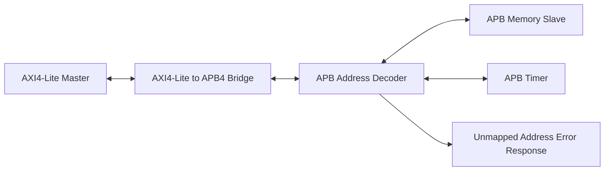
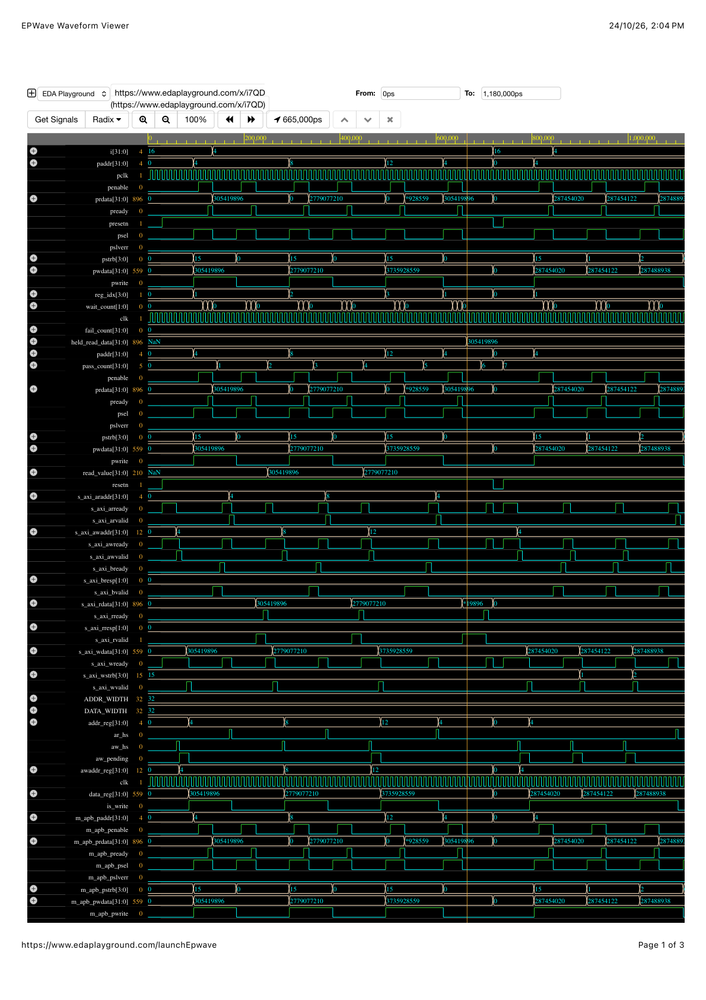
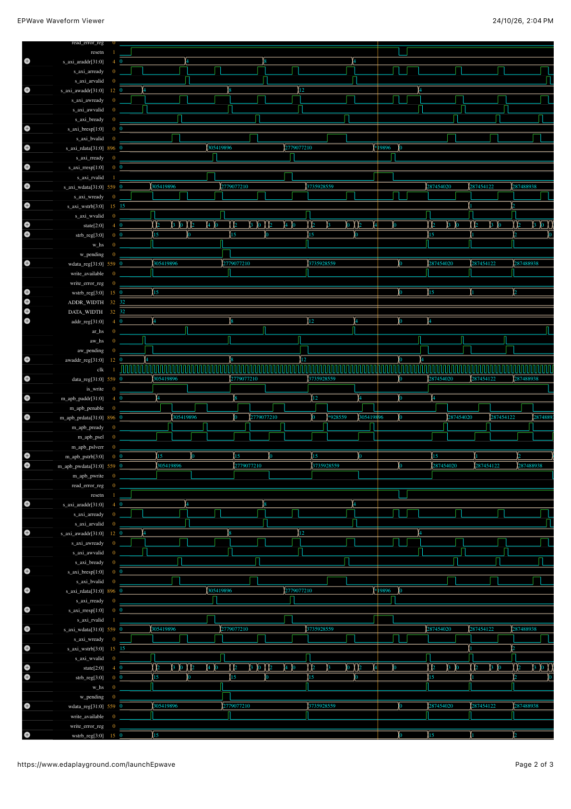

# AMBA AXI4-Lite to APB4 Bridge

A SystemVerilog-based AMBA protocol project implementing an **AXI4-Lite to APB4 bridge** with memory and timer peripherals. This project demonstrates protocol conversion, AXI channel handshaking, byte-level write support, APB wait-state handling, address decoding, and simulation-based verification.

## Overview

The bridge converts AXI4-Lite read and write transactions into APB transfers. It connects an AXI4-Lite master to APB memory and timer peripherals and returns the appropriate AXI responses.

The subsystem supports:
- AXI4-Lite read and write transactions
- APB setup and access phases
- Byte strobes using AXI `WSTRB` and APB `PSTRB`
- Memory and timer register accesses
- Error responses for unmapped addresses
- Self-checking and randomized simulation tests

## Architecture



## Key Features

- AXI4-Lite to APB4 protocol conversion.
- Independent AXI write-address and write-data handshakes.
- AXI read and write response handling.
- Byte-level writes using `WSTRB` to `PSTRB` propagation.
- APB setup/access sequencing and peripheral wait-state support.
- Memory and timer peripheral integration.
- Address decoding and `SLVERR` responses for unmapped accesses.
- APB assertion checks and self-checking testbenches.
- Randomized AXI byte-write verification.
- VCD waveform generation for simulation debugging.

## Address Map

| Address | Peripheral / Register | Description |
|---|---|---|
| `0x0000_0000` – `0x0000_003C` | Memory | Word-aligned memory locations exercised by the randomized test |
| `0x0000_1000` | Timer control | Timer control register |
| `0x0000_1004` | Timer counter | Timer counter register |
| `0x0000_2000` | Unmapped | Example invalid address returning `SLVERR` |

The memory region shown above reflects the 64-byte address window used by the subsystem decoder. The timer counter can change while the timer is enabled, so its value depends on when it is sampled.

## Project Structure

```text
AMBA_PROTOCOL/
├── rtl/
│   ├── axi_to_apb_bridge.sv
│   ├── apb_slave.sv
│   ├── apb_timer.sv
│   └── apb_subsystem.sv
├── tb/
│   ├── apb_sva.sv
│   ├── tb_apb.sv
│   ├── tb_apb_self_checking.sv
│   ├── tb_apb_sva_check.sv
│   ├── tb_apb_sva_valid.sv
│   ├── tb_axi_bridge.sv
│   ├── tb_axi_random.sv
│   ├── tb_multislave_subsystem.sv
│   └── tb_apb_subsystem.sv
├── docs/
│   └── images/
├── run_all.sh
└── README.md
```

## Verification Results

The latest observed regression completed successfully with all six test suites passing.

| Test suite | Observed result |
|---|---|
| APB valid assertion test | PASS |
| APB self-checking test | PASS |
| AXI bridge test | PASS |
| Multi-slave subsystem test | 6/6 PASS |
| Randomized AXI byte-write test | 100 readbacks passed, 0 failed |
| Integrated AXI-to-APB subsystem test | 12 checks passed |

The randomized test exercised 100 write/read transactions. The integrated subsystem test checked memory accesses, partial-byte writes, timer accesses, and an unmapped-address error response.

These are simulation results observed during development; they do not by themselves establish formal protocol compliance or successful hardware synthesis.

## Run the Regression

### Requirements

- Icarus Verilog (`iverilog` and `vvp`)
- Bash-compatible terminal
- Git

### Clone the Repository

```bash
git clone https://github.com/singhjavinash-cmd/AMBA_PROTOCOL.git
cd AMBA_PROTOCOL
```

### Run All Test Suites

```bash
chmod +x run_all.sh
./run_all.sh
```

If the script is not executable, run:

```bash
bash run_all.sh
```

A successful regression should finish with:

```text
ALL 6 TEST SUITES PASSED
```

## Waveform Results

The following waveform screenshots illustrate AXI-to-APB bridge activity, including address and data transfers, APB control signals, and byte-strobe propagation.

### AXI-to-APB Bridge Waveform — Page 1



### AXI-to-APB Bridge Waveform — Page 2



Additional waveform files are available in `docs/images/`.

## Technologies

- SystemVerilog
- AMBA AXI4-Lite
- AMBA APB4
- Icarus Verilog
- VCD waveform simulation
- Git and GitHub

## Future Improvements

- Expand assertions for AXI and APB protocol corner cases.
- Add functional coverage and additional randomized scenarios.
- Test reset during active transfers and prolonged response backpressure.
- Add dedicated timing diagrams for read and write transactions.
- Run lint and synthesis checks using a compatible toolchain.
- Consider FPGA implementation after validating tool and device compatibility.

## Repository

[View AMBA_PROTOCOL on GitHub](https://github.com/singhjavinash-cmd/AMBA_PROTOCOL)

## Project Scope

This project implements an **AXI4-Lite-to-APB4 bridge subsystem**, not the entire AMBA protocol family. The focus is protocol conversion, peripheral integration, and simulation-based verification.
