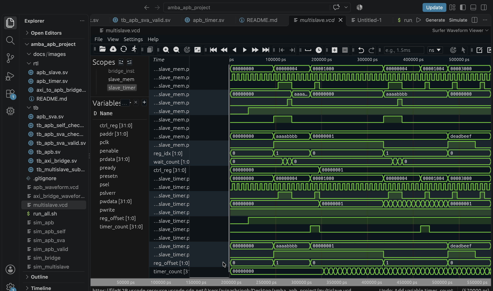

# AXI4-Lite to APB Multi-Slave Interconnect

A synthesizable SystemVerilog project implementing an AXI4-Lite to APB bridge with memory and timer peripherals.

## Features
- AXI4-Lite read and write channel handling
- AXI4-Lite to APB protocol bridge
- APB memory slave with wait-state behavior
- APB timer peripheral
- Address decoding and SLVERR responses for unmapped accesses
- APB protocol checking and self-checking testbenches

## Simulation Waveforms

### AXI4-Lite Bridge


### Multi-Slave Subsystem


### APB Memory and Timer Slaves


## Run the Regression

```bash
chmod +x run_all.sh
./run_all.sh

cat > README.md <<'EOF'
# AXI4-Lite to APB Multi-Slave Interconnect

A synthesizable SystemVerilog project implementing an AXI4-Lite to APB bridge with memory and timer peripherals.

## Features
- AXI4-Lite read and write channel handling
- AXI4-Lite to APB protocol bridge
- APB memory slave with wait-state behavior
- APB timer peripheral
- Address decoding and SLVERR responses for unmapped accesses
- APB protocol checking and self-checking testbenches

## Simulation Waveforms

### AXI4-Lite Bridge


### Multi-Slave Subsystem


### APB Memory and Timer Slaves


## Run the Regression

```bash
chmod +x run_all.sh
./run_all.sh
