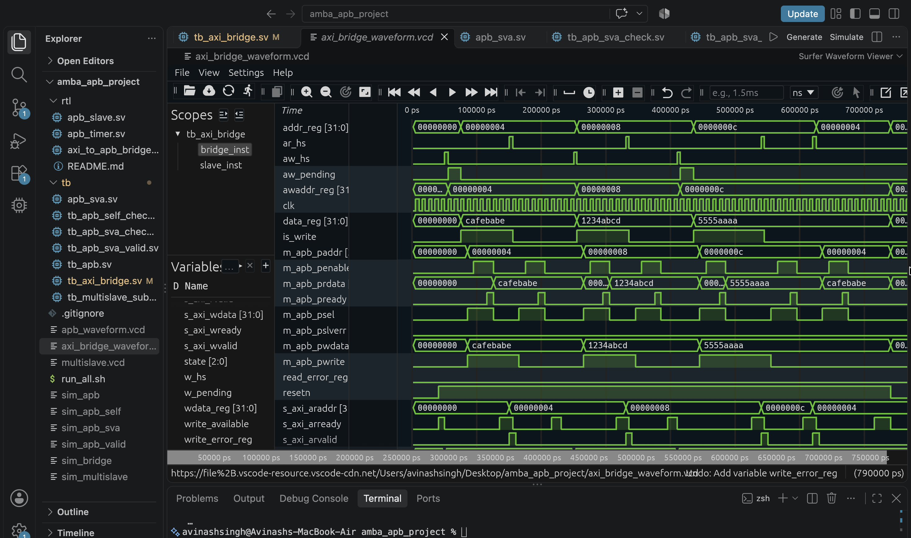
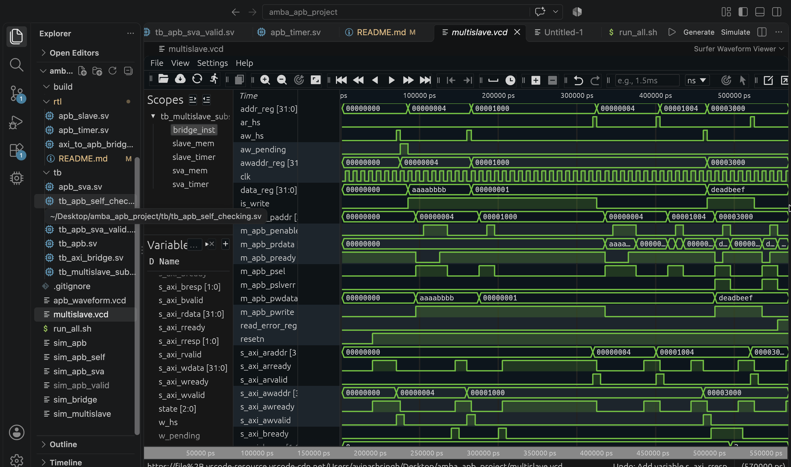

# AXI4-Lite to APB Multi-Slave Interconnect Subsystem

A synthesizable SystemVerilog implementation of an AXI4-Lite to APB bridge with a multi-slave peripheral subsystem, protocol checks, and automated simulation regression.

## Architecture Overview

- **AXI4-Lite interface:** Supports the five independent channels: AW, W, B, AR, and R.
- **Protocol bridge:** Uses a finite-state machine (FSM) to manage APB setup/access phases and AXI responses.
- **APB peripherals:** Includes a memory-mapped APB slave and an APB timer peripheral.
- **Address decoding:** Routes accesses to the memory and timer and returns `SLVERR` for tested unmapped accesses.
- **Verification:** Includes directed AXI bridge tests, APB self-checking tests, APB protocol-checker tests, and multi-slave subsystem tests.
- **Regression:** Runs the main test suites through `run_all.sh`.

## Architecture Diagram

```text
              AXI4-Lite Master
                     |
           +----------------------+
           | AXI4-Lite to APB     |
           | Bridge (FSM)         |
           +----------------------+
                     |
               APB Master
                     |
           +----------------------+
           | APB Address Decoder  |
           +----------------------+
                |            |
          0x0000_0XXX   0x0000_1XXX
                |            |
        +---------------+ +---------------+
        | APB Memory    | | APB Timer     |
        | Slave         | | Peripheral    |
        +---------------+ +---------------+
                |
        Unmapped addresses
        return SLVERR
```

## Memory Map

| Peripheral | Address Range | Access |
|---|---|---|
| APB Memory | `0x0000_0000` – `0x0000_0FFF` | Read / Write |
| APB Timer | `0x0000_1000` – `0x0000_1FFF` | Read / Write |
| Unmapped Space | `0x0000_2000` and above | Error response for tested accesses |

## Project Structure

```text
amba_apb_project/
├── rtl/
│   ├── apb_slave.sv
│   ├── apb_timer.sv
│   ├── axi_to_apb_bridge.sv
│   └── README.md
├── tb/
│   ├── apb_sva.sv
│   ├── tb_apb_self_checking.sv
│   ├── tb_apb_sva_check.sv
│   ├── tb_apb_sva_valid.sv
│   ├── tb_apb.sv
│   ├── tb_axi_bridge.sv
│   └── tb_multislave_subsystem.sv
├── docs/
│   └── images/
│       └── multislave_waveform.png
├── run_all.sh
└── .gitignore
```

## Tools

- SystemVerilog
- Icarus Verilog (`iverilog`, `vvp`)
- Surfer waveform viewer or another VCD-compatible viewer
- Git and GitHub

## Run the Regression

From the project root directory:

```bash
bash run_all.sh
```

The script runs four main test suites:

1. APB valid assertion test
2. APB self-checking test
3. AXI bridge test
4. Multi-slave subsystem test

The intentionally failing APB checker test is run separately because it deliberately introduces a protocol violation.

## Verification Summary

The latest reported regression results include:

| Test | Expected Result | Status |
|---|---|---|
| Valid APB transaction | No protocol-checker errors | PASS |
| APB self-checking test | All four read checks pass | PASS |
| AXI4-Lite bridge | Five directed tests pass | PASS |
| Memory write | `BRESP = OKAY` | PASS |
| Timer enable write | `BRESP = OKAY` | PASS |
| Memory read | `0xAAAA_BBBB` | PASS |
| Timer counter read | Counter value returned | PASS |
| Unmapped write | `BRESP = SLVERR` | PASS |
| Unmapped read | `RRESP = SLVERR` | PASS |

The multi-slave testbench reported **6/6 tests passed**. The AXI bridge testbench reported **5/5 tests passed**.

The negative APB checker test intentionally changes transfer signals during a wait state and should report a checker error. This is expected behavior for that negative test.


## AXI4-Lite Bridge Waveform



*Figure: AXI4-Lite bridge simulation showing write/read handshakes, response backpressure, and reset behavior.*

## Multi-Slave Subsystem Waveform



*Figure: Multi-slave simulation showing APB transfers, memory and timer accesses, address decoding, and error responses.*

## View the Waveform

1. Run the multi-slave simulation or the regression script.
2. Open the generated `multislave.vcd` file in Surfer or another VCD-compatible waveform viewer.
3. Add relevant signals such as `pclk`, `presetn`, `psel`, `penable`, `pwrite`, `paddr`, `pwdata`, `prdata`, `pready`, and AXI handshake/response signals where available.
4. Zoom in on setup, access, wait-state, and response phases.
5. Capture a screenshot and save it as `docs/images/multislave_waveform.png`.

## Scope and Limitations

This project implements an AXI4-Lite-to-APB bridge and a multi-slave APB subsystem. The listed tests exercise selected protocol and subsystem behaviors; they do not prove complete compliance with every AXI4-Lite or APB specification requirement.

The APB checker uses procedural checks. It is not a complete formal verification environment.

## Future Improvements

- Expand protocol assertions and negative testing.
- Add randomized testing and broader corner-case coverage.
- Improve coverage reporting.
- Add synthesis and timing-analysis results where supported by the available toolchain.
